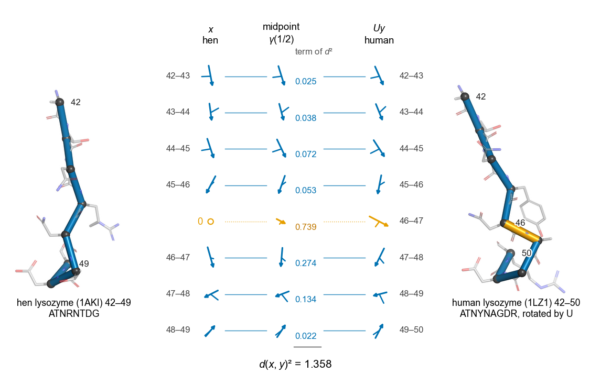
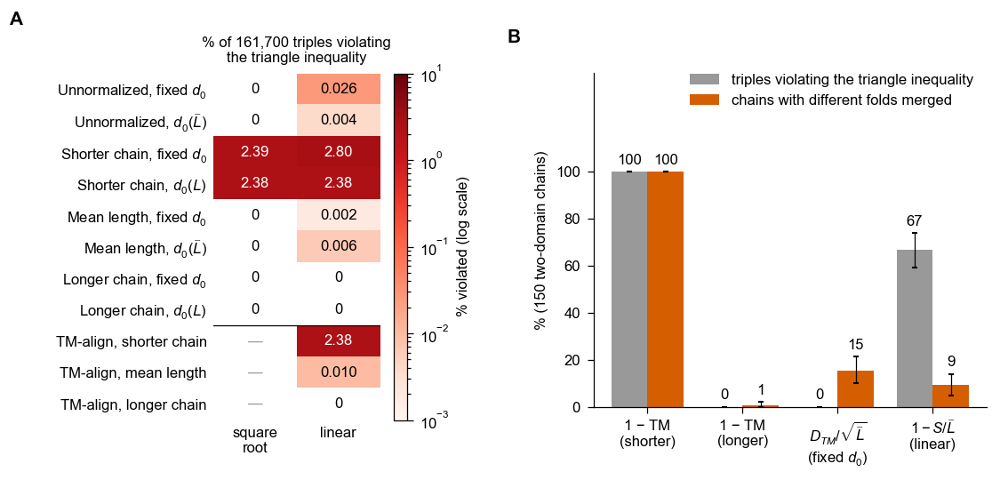
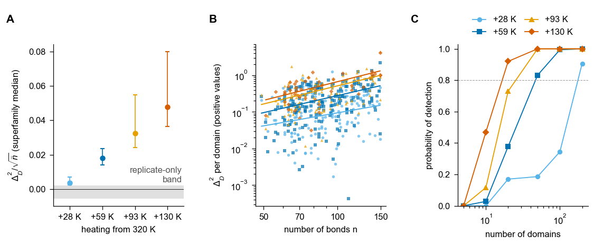
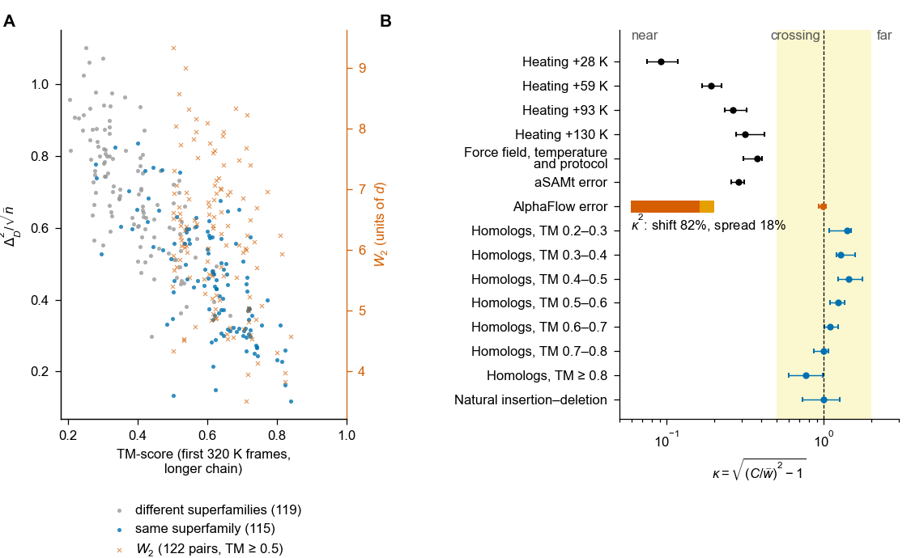
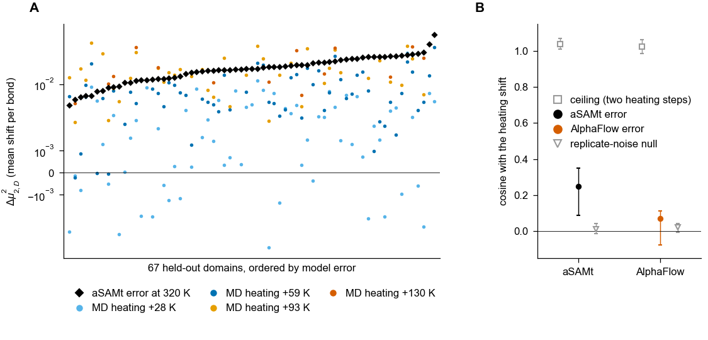
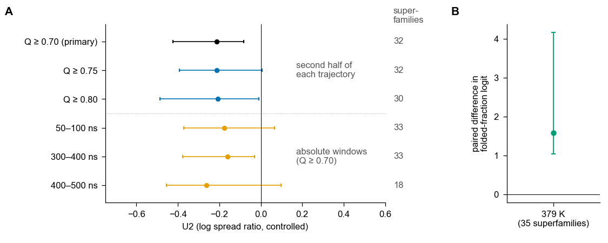
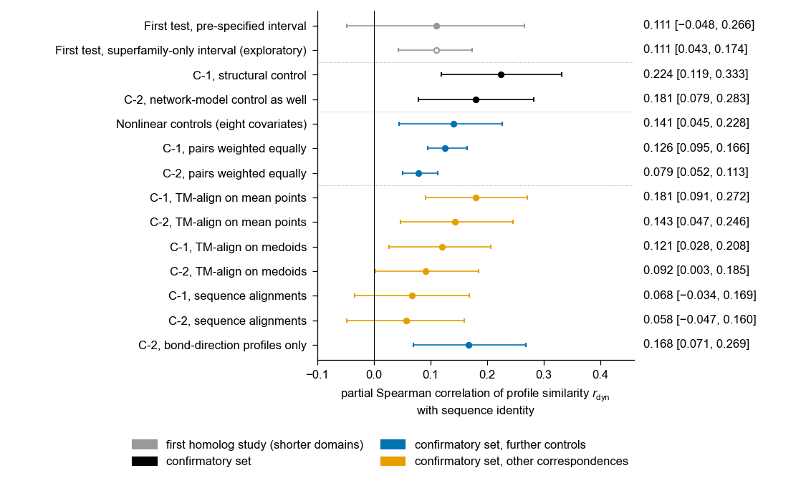

<h1 align="center">Comparing protein conformational ensembles<br>across sequences and lengths</h1>

<p align="center">
  <b>Hyeonsu An</b><br>
  Department of Applied Artificial Intelligence, Sungkyunkwan University, Seoul, Republic of Korea
</p>

<p align="center">
  Manuscript submitted · Analysis code exactly as run · Version 1.3.0 · MIT license · Zenodo DOI to be added at release
</p>

<p align="center">
  <a href="#abstract">Abstract</a> ·
  <a href="#results-at-a-glance">Results</a> ·
  <a href="#reproducing-the-figures-and-tables">Reproducing the paper</a> ·
  <a href="#time-stamped-records">Time-stamped records</a> ·
  <a href="#citation-and-license">Citation</a> ·
  <a href="https://github.com/gaony571/framedchain">framedchain package</a>
</p>

<p align="center">
  
</p>

**Fig 1. Framed chains and the edit distance.** (A) Each virtual Cα–Cα bond i is represented by x<sub>i</sub> = s<sub>i</sub>R<sub>i</sub>/2,
the frame [f₁, f₂, f₃] of the bond and its peptide plane scaled by the relative bond length (f₃ points out of the
page). (B) Two chains of different lengths are aligned by an order-preserving correspondence and one global rotation;
unmatched bonds face zero matrices. (C) The squared distance splits exactly into shared-bond and unshared-bond parts.
(D) The geodesic between the chains: shared terms move linearly, unshared terms shrink to or grow from zero.

This repository contains the code exactly as it was run to produce every number, figure and table of the paper,
together with the run queues, environment records and the time-stamped records that fixed each analysis before it
was run. To apply the method to your own structures and ensembles, use the documented and tested Python package
[framedchain](https://github.com/gaony571/framedchain) (version 0.4.1) instead; this repository is for checking
and reproducing the paper.

## Abstract

Proteins are increasingly described as conformational ensembles, but no common geometry holds structures and ensembles of different sequences and lengths: most ensemble measures assume identical sequences, and residue-pair comparisons drop unpaired residues. Here I represent protein backbones of any length as framed chains. Each virtual Cα–Cα bond becomes a 3×3 matrix, the orthonormal frame of the bond and its peptide plane scaled by bond length; an absent bond is the zero matrix, the only rotation-invariant choice. Minimizing Euclidean distance between chains over global rotations and insertions of absent bonds gives an order-preserving edit-distance metric across lengths; at any optimal alignment, which can be certified, its square splits exactly into shared-bond and unshared-bond parts. Likewise, the score that TM-align maximizes, with its distance scale fixed, converts exactly into an edit-distance metric on α-carbon positions modulo rigid motion. For ensembles, energy statistics corrected for replicate noise are unbiased under any underlying metric. Calibrated on same-sequence temperature responses, they are invariant in expectation to replicate and frame numbers but grow with domain size, which comparisons must account for. Once correspondence and rotation are fixed, within or across sequences, the space is Euclidean, so mean shifts and fluctuations can be compared bond by bond. On held-out domains, the mean-shift errors of a temperature-conditioned generative model match or exceed the same domains' shifts under 59 K heating, yet are largely orthogonal to the heating direction. In a pre-specified replication across 32 superfamilies, thermophilic domains fluctuate less on shared bonds than mesophilic homologs at equal temperature. In a confirmatory set of 4,152 pairs of larger homologous domains, shared-bond fluctuation profiles grow modestly more similar with sequence identity beyond shared-core structure, elastic-network predictions and nonlinear controls; in shorter domains, the association does not survive the nonlinear controls. Ensembles across sequences thus become comparable in one geometry.

## Results at a glance

The figures below are the paper's figures as drawn by `code/make_figs.py` from the stored results (150 dpi PNG; the
submitted 600 dpi TIFF files come from the same script). Captions are shortened; the full captions are in the paper,
and [`docs/RESULTS_MAP.md`](docs/RESULTS_MAP.md) maps every value to its script and output file.

### TM-score-based distances



**Fig 2. The TM-align objective and TM-score-based distances.** (A) Triangle-inequality violations among 161,700
triples for each normalization and transform of the TM-align score: violations appear only with shorter-chain
normalization (2.4–2.8% of triples) or with linear forms without a square root; D<sub>TM</sub> and D<sub>TM</sub>/√L̄ with a fixed d₀
are proven metrics. (B) Under average linkage, 1 − TM-score normalized by the shorter chain merges different folds in
all 150 two-domain chains tested, against 15% for D<sub>TM</sub>/√L̄; the linear form 1 − S/L̄ violates the triangle inequality
in 67% of triples yet chains in only 9%, so chaining comes from shorter-chain normalization.
*Code:* `pu_tm_factorial_v2.py`, `chaining.py`, `c4_chain_extra.py`.

### Calibration on same-sequence heating



**Fig 3. Calibration on same-sequence heating.** (A) The energy statistic Δ²<sub>D</sub>/√n̄ for heating from 320 K by +28 to
+130 K in mdCATH, against the band of replicate-only comparisons. (B) Per domain, Δ²<sub>D</sub> grows with the number of bonds
as n<sup>α</sup> with α = 1.2–1.7, so magnitudes are compared within domains or between size-matched sets. (C) Probability of
detecting each heating step as a function of the number of domains.
*Code:* `r39_D_stem.py`, `r39_core.py`.

### Ensembles of different sequences on one statistic



**Fig 4. Ensembles of different sequences on the same statistic.** (A) Over 234 domain pairs, Δ²<sub>D</sub>/√n̄ falls steadily
as the domains grow more similar in structure (Spearman with TM-score −0.83), shown with the optimal-transport
distance W₂ for the 122 pairs with TM-score ≥ 0.5. (B) The ratio κ places each comparison in the near, crossing or far
regime: heating, a change of force field, temperature and protocol, and the aSAMt error are near, whereas homolog pairs and the AlphaFlow error
lie in the crossing band.
*Code:* `r38_b6.py`, `r43_sens.py`, `r44_inv.py`.

### Errors of a temperature-conditioned generative model



**Fig 5. Errors of a temperature-conditioned generator against heating of the same domains.** (A) For 67 held-out
domains, the mean-shift error of aSAMt at 320 K relative to MD (diamonds) against the same domains' responses to
+28 to +130 K of simulated heating (circles); the error lies at or above the response to +59 K. (B) The error is largely orthogonal to the heating direction
(cosine 0.25 [0.09, 0.35], against a ceiling near 1 for two heating steps); AlphaFlow's error is nearly orthogonal.
*Code:* `r38_asamt_gen.py`, `r38_p2_D.py`, `r38_p2_aggregate_D.py`, `r39_e5prep.py`, `r39_core.py`.

### Thermophilic and mesophilic homologs at equal temperature



**Fig 6. Thermal adaptation at equal temperature.** (A) In a pre-specified replication over 32 superfamilies,
thermophilic domains fluctuate less on shared bonds than their mesophilic homologs at 320 K, relative to
mesophile–mesophile controls (U2 = −0.21, one-sided 97.5% upper bound −0.08; a shared-bond variance about 19% lower),
shown at three native-state thresholds and in absolute trajectory windows. (B) Positive control: thermophilic domains
keep a larger folded fraction at 379 K.
*Code:* `r38_p1n.py`, `r44_p1win.py`.

### Sequence identity and shared-bond fluctuation profiles



**Fig 7. Sequence identity and shared-bond fluctuation profiles.** Partial correlation of fluctuation-profile
similarity with sequence identity. The first test, on shorter domains, was inconclusive; in a confirmatory set of
4,152 pairs of larger domains, profiles grew more similar with identity beyond shared-core structure (C-1: 0.224
[0.119, 0.333]) and beyond elastic-network predictions as well (C-2: 0.181 [0.079, 0.283]). The estimate is smaller
with TM-align correspondences and not detected with sequence alignments.
*Code:* `r38_p3.py`, `r38_p3_explore2.py`, `r38_c.py`, `r38_c_nl.py`, `r44_pairw.py`, `r45_f1.py`, `r44_corr_v2.py`, `r44_corr2.py`.

The supporting figure (S1 Fig, the general lemma on synthetic sequences) is in [`figures/S1_Fig.png`](figures/S1_Fig.png).

## Reproducing the figures and tables

Each item of the paper is listed with the scripts that computed its values (in `code/`) and the script that drew it.
[`docs/RESULTS_MAP.md`](docs/RESULTS_MAP.md) gives the full map, down to output files and record entries, and
[`docs/SCRIPTS.md`](docs/SCRIPTS.md) describes every script in English.

| Paper | Computed by | Drawn by |
|---|---|---|
| Fig 1 | — (schematic) | `make_figs.py` |
| Fig 2 | `pu_tm_factorial_v2.py` (A, factorial comparison of TM-score forms); `chaining.py`, `c4_chain_extra.py` (B, chaining) | `make_figs.py` |
| Fig 3 | `r39_D_stem.py`, `r39_core.py` (calibration on heating, size dependence, detection probability) | `make_figs.py` |
| Fig 4 | `r38_b6.py` (A, comparison across sequences, with W₂); `r43_sens.py` (B, κ of each cell); `r44_inv.py` (split of κ² for AlphaFlow) | `make_figs.py` |
| Fig 5 | `r38_p2_D.py`, `r38_p2_aggregate_D.py`, with the ensembles of `r38_asamt_gen.py` (A, model error against heating); `r39_e5prep.py`, `r39_core.py` (B, direction) | `make_figs.py` |
| Fig 6 | `r38_p1n.py` (replication of the thermophile difference, folded fraction at 379 K); `r44_p1win.py` (absolute windows) | `make_figs.py` |
| Fig 7 | `r38_p3.py`, `r38_p3_explore2.py` (first test); `r38_c.py`, `r38_c_nl.py`, `r44_pairw.py`, `r45_f1.py` (confirmatory set); `r44_corr_v2.py`, `r44_corr2.py` (other correspondences) | `make_figs.py` |
| Table 1 | — (comparison with prior approaches) | — |
| Table 2 | `r44_inv.py` (replicates, frames); `r39_core.py` (window); earlier audits of row 3.1 of `docs/RESULTS_MAP.md` (window, survival) | — |
| Table 3 | `r44_corr_v2.py`, `r44_corr2.py` | — |
| S1 Fig | `r41_synth_adv.py` | `make_figs.py` |
| S1 Table | the time-stamped records | `make_s1.py` |
| S2 Table | `r43_sens.py` | `make_tables.py` |
| S3 Table | `r46_align_fix1.py` (alignment accuracy), `r48_identity_range.py` (identity range) | `make_tables.py` |
| S1 Text | proofs; numerical checks in `framespace_wip/tests_stage0` and in the framedchain tests | — |
| S2 Text | `r38_s0.py`, `r38_s0_bias2.py` (reduced computation, U-statistic, alignment uncertainty, truncated chains); `r38_static.py`, `r39_sec6.py` (certification); `r39_roundtrip.py`; `r41_compute_prep.py`, `r41_compute.py` (cost); `pu_tm_factorial_v2.py`, `pu_tm_d0_sensitivity.py`, `framespace_wip/experiments/sippl_linear_counterexample.py`, `chaining.py`, `c4_chain_extra.py` (Section 8) | — |
| S3 Text | `code/negtype/*.js` (negative type, η₊); `r39_core.py` (size dependence) | — |

The numbers in the text are mapped section by section in the first table of `docs/RESULTS_MAP.md` (for example the
first thermophile test, `r38_p1.py`, and the ranking of existing measures, `hu1_rulers.py`).

The checks that wrote no output file (12 test pairs, reversed chains, equipment of the cost measurement,
decomposition of the unshared part, location of correspondence shifts, chain breaks, reproduction by framedchain
0.4.1) are given with their code and printed output in [`docs/INTERACTIVE_CHECKS.md`](docs/INTERACTIVE_CHECKS.md).

Reproduction is possible at three levels:

1. **Check a number** against the deposited summary tables in `results/`: each row of `docs/RESULTS_MAP.md` names
   the file that holds it, and the figure and table scripts read only these files.
2. **Recompute a statistic** from the deposited per-domain intermediates (CPU, minutes to hours), for example
   `python code/r38_p3.py "$ROOT" stats`.
3. **Rerun from the public data** (GPU, days in total): download the inputs and run the stages in the order given
   below. The generated model ensembles are stochastic; the deposit contains the ensembles that were analyzed.

## Quick start (no downloads, CPU, a few minutes)

```bash
pip install -r environment/requirements-check.txt
python examples/demo_synthetic.py            # compare with examples/demo_expected_output.txt
PYTHONPATH=framespace_pkg python -m pytest -q framespace_wip/tests_stage0
```

The pinned versions need Python 3.12 or newer. On Windows set the path first (`set PYTHONPATH=framespace_pkg` in
cmd, `$env:PYTHONPATH = "framespace_pkg"` in PowerShell) and run `python -m pytest ...` without the prefix.

- `examples/demo_synthetic.py` applies the paper's computations to small synthetic ensembles with the as-run
  libraries: invariances and the triangle inequality of the edit distance, the reduced computation used for
  frame pairs (identical to `red_pairs` in `code/r38_s0.py`) against the full search, and the energy statistic Δ²
  for a null comparison, a change in fluctuations and an insertion of four bonds. It is deterministic and takes
  about 30 s.
- The 25 tests of the research module run against the as-run library (about 3 minutes).
- Both were checked on 2026-10-26 with Python 3.12.13 and the versions in `environment/requirements-check.txt`.
  The tests of the method itself are in the framedchain package (46 tests in version 0.4.1).

## Running the analyses

All scripts take the project root as their first argument and read and write under it:

```
ROOT/
  code/              this repository's code/ (scripts load each other from here with exec)
  code/ext/alphaflow AlphaFlow repository, commit 0408d7c (only for the AlphaFlow steps)
  framespace_pkg/    this repository's framespace_pkg/
  framespace_wip/    this repository's framespace_wip/
  raw/               downloaded inputs (docs/DATA.md)
  derived/           per-domain intermediates written by the scripts
  results/           summary tables, time-stamped records, logs (results/logs/*.done)
```

A typical call is

```bash
python code/r38_p3.py "$ROOT" pairs,dom,pibar,pair,stats 3
```

where the second argument lists stages and the optional third is the number of worker processes. Stages are
resumable: finished per-domain files are skipped. Scripts add `ROOT/framespace_pkg` and `ROOT/framespace_wip` to
`sys.path` themselves, so do not install another version of the library into the same environment. Several scripts
load functions from another script with `exec` (for example `r38_b6.py` loads part of `r38_s0.py`), so keep `code/`
flat and unchanged. The commands that were actually run, with their arguments, are in `run_records/queues/`.

Scripts named `r37` to `r48` carry the stage of the project in which they were written; the others (data
preparation and the early CPU-only analyses) have descriptive names. From the public data, the analyses run in
this order:

1. **Inputs.** Download the public data into `raw/` and place the deposited intermediate tables in `results/` and
   `derived/` (`docs/DATA.md`).
2. **Simulation frames.** `mdcath_5T_extract.py`, `mdcath_5T_folded.py`, `c1_core.py`; `mdcath_spread.py` and
   `mdcath_spread_hot.py` for per-bond spreads (CPU).
3. **Comparison of TM-score forms and existing measures** (CPU): `pu_tm_factorial_v2.py`, `pu_tm_d0_sensitivity.py`,
   `hu1_rulers.py`, `chaining.py`, `c4_chain_extra.py`.
4. **Checks of the computation** (mostly GPU): `r38_s0.py`, `r38_s0_bias2.py`, `r38_static.py`, `r39_roundtrip.py`,
   `r39_sec6.py`, `r41_compute_prep.py`, `r41_compute.py`.
5. **Calibration on heating** (GPU, then CPU): `r39_D_stem.py`, `r39_core.py`, `r39_D_unfold.py`, `r39_e6.py`,
   `r38_e7_30.py`, `r38_e7_100.py`, `r41_dcomp.py`.
6. **Comparison across sequences and the other κ cells** (GPU): `r38_b6.py`, `r38_r10a.py` (insertion–deletion
   pairs), `r38_dff_D.py`, `r41_dff50.py` (force-field cell).
7. **Model errors** (GPU): `r38_prep.py`, `r38_md_ref.py`, `r38_asamt_gen.py` (samenv), `r38_alphaflow_gen.py`
   (afenv), `r38_compare.py`, `r38_p2_D.py`, `r38_p2_aggregate_D.py`, `r39_e5prep.py` and the other scripts of
   row 4.11 of `docs/RESULTS_MAP.md`.
8. **Thermophilic homologs** (GPU): `r38_p1.py`, `r38_p1_diag.py`, `r38_p1n_fetch.py`, `r38_p1n.py`.
9. **Sequence identity** (GPU, then CPU): `r38_p3.py`, `r38_p3_explore2.py`, `r38_c_fetch.py`, `r38_c.py`,
   `r38_c_nl.py`.
10. **Analyses added after the results:** `r43_sens.py`; `r44_*.py`, `r45_*.py`, `r46_*.py`,
    `r47_*.py`, `r48_identity_range.py`, `r49_chainbreak*.py`, each fixed in its own time-stamped record (`docs/RESULTS_MAP.md`).
11. **Figures and tables:** `make_figs.py`, `make_tables.py`, `make_s1.py`, which read stored results only; the
    project path is set at the top of each file.

For the main pre-specified analyses, `r38_verify_*.py` checked the implementation on synthetic data with known
answers before the run. The repository also contains scripts of project analyses that the paper does not report
(for example fold retrieval and a check of standard ensemble metrics); `docs/RESULTS_MAP.md` lists them.

## Time-stamped records

Hypotheses, predictions and decision rules were written into time-stamped records before the analyses they cover
were run (Methods and S1 Table of the paper). The first record, `results/prereg_2026-10-17.json`, is in the data
deposit together with its 101 retained versions; the twelve records added from 2026-10-28 and their five
corrections are also copied in `registration/` (the date in their file names is Korea Standard Time, UTC+9; times
inside are UTC). Where a record holds the md5 of a script, the file here has that checksum;
[`docs/PROVENANCE.md`](docs/PROVENANCE.md) lists the checksum of every file and whether it was recorded before the
run. A corrected script was recorded as a separate file with its own checksum, and analyses added after a result
are separate scripts that say so in their docstrings.

## Repository layout

| Path | Content |
|---|---|
| `code/` | Analysis scripts, one per experiment or stage; figure and table scripts (`make_figs.py`, `make_tables.py`, `make_s1.py`); four Node.js checks in `code/negtype/` |
| `framespace_pkg/framespace/` | The library exactly as used in the runs (framespace 0.2.0, the earlier name of framedchain; tag `v0.2.0` of the framedchain repository, bundle md5 `4edba596…`) |
| `framespace_wip/` | Research module used by the runs (reduced computation, measures, ESA and W₂ helpers) with its tests (bundle md5 `6703fa26…`), and the constructed counterexample for the linear form |
| `examples/` | Synthetic demonstration and its expected output |
| `figures/` | The paper's figures as PNG (150 dpi), drawn by `code/make_figs.py` from the stored results |
| `environment/` | Package lists (`requirements-base.txt` for the analysis scripts, `requirements-check.txt` for the demonstration and tests), setup scripts and `pip freeze` records of the model environments (`environment/README.md`) |
| `registration/` | Copies of the time-stamped records added from 2026-10-28, with their corrections, and of two entries of the first record |
| `run_records/queues/` | The shell and Python queues that ran the scripts, with their arguments |
| `docs/` | `RESULTS_MAP.md` (paper → scripts → outputs → records), `SCRIPTS.md` (every script in English), `DATA.md` (inputs, intermediates, deposit), `PROVENANCE.md` (checksums), `INTERACTIVE_CHECKS.md` (checks without an output file), `STATEMENTS.md` (draft availability statements) |
| `tools/` | `pack_for_zenodo.py` (builds the data deposit), `record_env.py` (records an environment) |
| `MANIFEST.md5` | md5 of every file (`md5sum -c MANIFEST.md5`) |

## Data

All inputs are public: the mdCATH and ATLAS simulations, CATH, RCSB PDB entries, SIFTS, and growth temperatures
from TEMPURA and Engqvist (2018). The model ensembles were generated with the released aSAM and AlphaFlow code
and weights. Summary tables, per-domain statistics, the generated ensembles, domain and pair lists and the
time-stamped records are deposited at Zenodo (DOI to be added). [`docs/DATA.md`](docs/DATA.md) lists every input
and intermediate with its source and license.

## Software and hardware

The analyses ran on Google Colab with the project directory on Google Drive: A100-SXM4-40GB runtimes (12 vCPUs)
for the GPU stages and, for some CPU stages, CPU-only runtimes or the CPUs of other runtimes (`environment/README.md`).

- **Base environment** (Python 3.12) for almost all scripts: `environment/requirements-base.txt`. Recorded
  versions: numpy 2.1 and mdtraj 1.11.2 (2026-10-19), torch 2.11.0+cu130 (2026-10-22), tmtools 0.3.0. This environment was not
  frozen at run time; `tools/record_env.py` records the one you use.
- **afenv** (Python 3.9, torch 1.12.1+cu113, OpenFold `103d037`) for AlphaFlow: `environment/afenv_freeze.txt`,
  `environment/setup_afenv3.sh`.
- **samenv** (Python 3.12, torch 2.6.0+cu124, sam2 `ce076ed`) for aSAMt: `environment/samenv_freeze.txt`,
  `environment/setup_samenv3.sh`.

External tools: AlphaFlow `0408d7c`, sam2 (aSAM) `ce076ed`, OpenFold `103d037`, US-align `23f14ff`, Foldseek
`10-941cd33`, tmtools 0.3.0. CPU stages take minutes to hours each; the GPU stages took days in total. Per-pair
timings are in S2 Text 7.

## Notes on the as-run code

- **Comments.** Docstrings and comments inside the scripts are in Korean, the working language of the project.
  They are not translated in place because the files are kept byte for byte as run; `docs/SCRIPTS.md` describes
  every script in English.
- **Names.** The library was called framespace up to version 0.3.3 and this repository framespace-paper; both
  were renamed on 2026-10-26 (GitHub redirects the old addresses). The as-run copies keep the old names
  (`framespace_pkg/framespace/`, `import framespace`, `framespace_wip/`) because their checksums are in the records.
- **Inputs made in notebooks.** Some inputs were produced in notebook cells that were not kept as scripts; they
  are deposited as data and listed in `docs/DATA.md`.
- **Paths.** Some paths are Colab-specific (`/content/...` scratch directories, `/usr/bin/python3`, the Drive
  project path in `environment/af_bar_readmeenv.sh` and at the top of the figure and table scripts). They are
  working directories, not inputs.

## Citation and license

If you use this code, please cite the paper and this repository (`CITATION.cff`; the Zenodo DOI will be added at
release):

```bibtex
@unpublished{An2026ensembles,
  author = {An, Hyeonsu},
  title  = {Comparing protein conformational ensembles across sequences and lengths},
  year   = {2026},
  note   = {Manuscript submitted}
}

@software{An2026framedchainpaper,
  author  = {An, Hyeonsu},
  title   = {framedchain-paper: analysis code for "Comparing protein conformational ensembles across sequences and lengths"},
  version = {1.3.0},
  year    = {2026},
  url     = {https://github.com/gaony571/framedchain-paper}
}
```

MIT license, copyright (c) 2026 Hyeonsu An (`LICENSE`). Third-party code is not included: AlphaFlow,
sam2, OpenFold, US-align and Foldseek are obtained from their own repositories under their own licenses.
